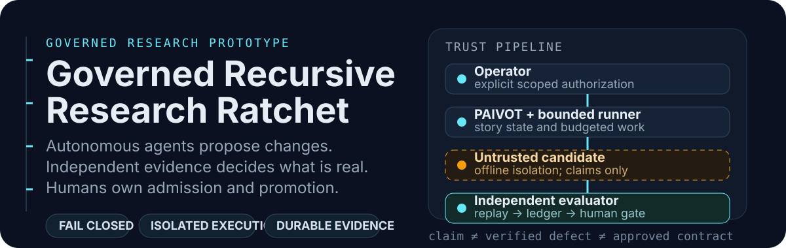

<p align="center">
  
</p>

GRRR is a governed research system for autonomous coding agents: untrusted
candidates run in isolation, an independent evaluator reproduces evidence, and
humans—not the optimizing agent—decide whether a result or verification contract
is admitted.

> **Status: research prototype, not a product release.**
> The public default branch is `epic/GRRR-2t3h`. The old `main` branch is the
> early Discovery & Framing snapshot. No license is granted yet.

## TL;DR

**The problem:** autonomous coding and research agents can generate useful
changes, but a self-grading agent can also leak holdouts, weaken checks, spend
unbounded budget, or report unreproducible success.

**The solution:** GRRR separates proposal, execution, verification, accounting,
review, admission, and promotion. Candidate observations are allegations until
an independent evaluator reproduces them. Even then, evidence review is not
contract admission or promotion authority.

| Capability | What GRRR enforces |
|---|---|
| Optimizer/evaluator separation | The agent that proposes work cannot own protected truth or grade itself |
| Isolated execution | Candidate code belongs behind an offline VM/process boundary |
| Fail-closed gates | Missing, malformed, errored, skipped, or unknown is never success |
| Durable evidence | Hash-linked records and immutable artifacts preserve what happened |
| Explicit budgets | Cost, runtime, and review limits remain visible and stoppable |
| Independent replay | A verified defect must reproduce from trusted inputs |
| Counterexample ratchet | A reviewed failure can become a permanent verification obligation |
| Human authority | Evidence acceptance, contract admission, promotion, and production mutation remain separate decisions |

## What currently works

This repository contains source, tests, evidence, and governed workflows—not a
finished end-to-end product.

Implemented or retained in the current integrated branch include:

- bounded runner lifecycle surfaces;
- trusted-observation and isolated corpus prerequisites;
- protected accounting/recovery records;
- durable evidence and safe-stop components;
- replay prerequisite and successor-contract validation;
- capstone backend contracts, schemas, launch/review components, and journal;
- independently reviewed fail-closed report and status work on story branches.

Not completed on this integrated branch:

- the full live operator capstone;
- reliable end-to-end independent replay under all gates;
- final contract admission and promotion qualification;
- autonomous implementation patch generation;
- a stable public API, package, installer, or production deployment.

Accepted work may exist on story branches before it is merged. In particular,
`story/GRRR-n49g` contains the accepted read-only status/report projection and
`story/GRRR-734u` contains the accepted prepared-not-issued replay namespace
planner.

## Quick source inspection

There is no installer and no curl installation path. The repository is intended
to be inspected and tested from a clone.

```bash
git clone https://github.com/jmanhype/governed-recursive-research-ratchet.git
cd governed-recursive-research-ratchet
git switch epic/GRRR-2t3h

# Inspect the runner grammar; this starts no experiment.
./bin/grrr --help

# Inspect stop/recovery grammar before doing anything else.
./bin/grrr stop --help
./bin/grrr recover --help

# Run the required stdlib-only source regression suite.
python3 -B tests/unit_capstone_backend_suite.py

# Inspect the historical replay report surface.
# Output is archived evidence only; it is not live state or approval authority.
./scripts/grrr-review --format text
```

Do not run `scripts/test-story`, provisioning scripts, or capstone-driver
commands blindly. Several are workflow-specific and intentionally fail when
protected inputs, identities, permissions, or authorization records are absent.

## Installation and requirements

### Source inspection and no-guest tests

- Git
- Python 3.9 or newer
- Standard library only for the required backend source suite
- No network access is required

The required suite has been developed and exercised on installed Python 3.9,
3.12, and 3.14 interpreters.

### Optional governance workflow

The Paivot control plane (`pvg` and `nd`) is not bundled as a package dependency.
It is used by the project workflow to claim, deliver, review, accept, and merge
stories. GitHub visibility does not install or configure Paivot.

### Live isolation and replay

Runtime execution additionally requires explicitly reviewed local assets and
permissions, including a pinned target, trusted runtime identity, offline VM or
equivalent isolation, protected evidence/accounting stores, and operator
authorization. Those assets are intentionally not auto-provisioned.

## Repository layout

| Path | Purpose |
|---|---|
| `research/` | Core runner, evaluator, accounting, replay, report, capstone, and governance source |
| `tests/` | Source-level unit, adversarial, integration-fixture, and workflow suites |
| `scripts/` | Review, preflight, verification, provisioning-plan, evidence, and workflow helpers |
| `corpus/` | Frozen challenge/corpus inputs |
| `bin/grrr` | Approved bounded synthetic runner entrypoint |
| `docs/` | Business, design, architecture, policy, implementation, and evidence records |
| `reports/` | Generated or retained report surfaces |
| `.paivot/` | Repository workflow configuration |

## Architecture

```text
                 ┌────────────────────────────┐
                 │ Operator / Product Owner   │
                 │ explicit scoped authority  │
                 └────────────┬───────────────┘
                              │
                 ┌────────────▼───────────────┐
                 │ PAIVOT / pvg / nd          │
                 │ story state and reviews    │
                 └────────────┬───────────────┘
                              │
                 ┌────────────▼───────────────┐
                 │ Research Runner            │
                 │ bounded lifecycle only     │
                 └──────┬──────────────┬──────┘
                        │              │
            ┌───────────▼───┐   ┌──────▼──────────────┐
            │ Selector      │   │ Trusted Evaluator   │
            │ random/det/   │   │ policy, corpus,     │
            │ optional Jev  │   │ gates, budget       │
            └───────────┬───┘   └──────┬──────────────┘
                        │              │
                        │       ┌──────▼──────────────┐
                        │       │ Isolated Executor   │
                        │       │ offline VM/process  │
                        │       └──────┬──────────────┘
                        │              │ untrusted observation
                        │       ┌──────▼──────────────┐
                        │       │ Independent Replay  │
                        │       │ verify/refuse       │
                        │       └──────┬──────────────┘
                        │              │
            ┌───────────▼──────────────▼──────────────┐
            │ Append-only ledger + immutable evidence │
            └────────────────────┬────────────────────┘
                                 │
            ┌────────────────────▼────────────────────┐
            │ Operator review / PM acceptance         │
            │ evidence ≠ admission ≠ promotion        │
            └─────────────────────────────────────────┘
```

### Trust rules

1. A selector ranking is probabilistic advice, not truth.
2. Candidate output is an allegation, never a verdict.
3. The evaluator owns protected truth and ledger authority.
4. The runner cannot supply expected results or bypass mandatory gates.
5. Missing evidence remains missing; unknown cost is not `$0`.
6. A 9-of-11 historical gate snapshot is not a 9-of-9 profile.
7. Independent reproduction is not human approval.
8. Human approval of evidence is not permanent contract admission.
9. Contract admission is not software promotion.
10. Promotion is not production deployment.

## Command reference

### `bin/grrr`

Bounded synthetic walkthrough entrypoint. It does not modify PAIVOT core.

```bash
./bin/grrr --help
./bin/grrr status RUN_ID
./bin/grrr review RUN_ID
./bin/grrr evidence --level decision --format text RUN_ID
./bin/grrr evidence --level technical --format markdown RUN_ID
./bin/grrr evidence --level audit --format json RUN_ID
./bin/grrr stop --reason "operator review" RUN_ID
```

`start` requires exact policy, challenge, and variant inputs. Help output is a
safe way to inspect the grammar; do not invent identifiers.

### `scripts/grrr-review`

Reads a fixed archived replay export and renders text, Markdown, or JSON.

```bash
./scripts/grrr-review --format text
./scripts/grrr-review --format markdown
./scripts/grrr-review --format json
```

On the current integrated branch, this historical surface can show a misleading
zero-dollar cost and a 9-of-11 gate result. It must not be used as approval
authority. The accepted fail-closed projection is retained on
`story/GRRR-n49g` pending merge.

### `scripts/capstone-driver`

Prepares and runs reviewed capstone plans.

```bash
./scripts/capstone-driver prepare --request REQUEST.json
./scripts/capstone-driver run --plan PLAN.json --request REQUEST.json
```

Malformed, stale, unauthorized, or incomplete requests are expected to fail.
Do not create requests by copying private or production data.

### `scripts/test-story`

Runs a named workflow suite.

```bash
# Calling the script with no arguments lists its supported suites.
./scripts/test-story

# Then invoke a named suite only after reviewing that story/script.
# ./scripts/test-story capstone-journal
```

Review the relevant story and script before invoking workflow-specific suites.

### `scripts/verify-evidence`

This script expects an evidence path as its positional argument.

```bash
./scripts/verify-evidence docs/evidence/PATH/TO/EVIDENCE.json
```

Verification failure is evidence of a real mismatch or unsupported package, not
an instruction to disable the verifier.

## Comparison

| Concern | GRRR | Ordinary test suite | Self-grading optimizer loop |
|---|---|---|---|
| Optimizer separated from evaluator | Yes | Partial | No |
| Candidate runs in disposable isolation | Required | Not enforced | Often not enforced |
| Protected holdouts/specs | Evaluator-owned | Often process-enforced only | Frequently exposed |
| Missing gate behavior | Blocks | Depends on runner | Often warning/skip |
| Cost and stop state | First-class | Usually external | Often after-the-fact accounting |
| Evidence ledger | Append-only/hash-linked | Logs only | Agent-reported |
| Replay | Independent and required | Usually local rerun | Self-reported |
| Contract admission | Separate human gate | Automatic test addition | Often automatic |
| Promotion/production | Separate explicit authority | Manual | Sometimes automated |

GRRR is slower and more ceremonial than a simple optimization loop. That is
deliberate: the goal is trustworthy compounding verification, not the largest
quantity of agent-proposed changes.

## Roadmap

1. **Finish source integration:** merge accepted report/status and replay
   namespace branches into the integrated epic branch.
2. **Restore a fresh replay runtime:** preserve prior accounting and evidence
   while creating a distinct execution namespace.
3. **Run the bounded capstone:** exercise operator authorization, isolated
   execution, evaluator replay, stop/recovery, ledger, reports, and accessibility
   as one journey.
4. **Close the verification ratchet:** independently reproduce a defect, review
   it, admit a contract, and prove recurrence rejection.
5. **Evaluate optional research components:** Jev prioritization, Harness²-style
   adaptation, and Sean Chatman’s Anti-Cheat Scorecard remain measured candidates,
   not trusted prerequisites.

## Troubleshooting

### “I cloned the repository but saw no code”

The old `main` branch is only the early Discovery & Framing snapshot. Switch to
the integrated branch:

```bash
git switch epic/GRRR-2t3h
```

The GitHub default branch has also been changed to this branch.

### “The backend suite ran zero tests”

Run the suite file directly and check its printed test count:

```bash
python3 -B tests/unit_capstone_backend_suite.py
```

The required runner intentionally fails on zero tests and skipped mandatory
tests.

### “A workflow script failed because protected state is missing”

That is often the correct result. Provisioning, `/Library/GRRR`, VM identities,
accounting stores, replay namespaces, and credentials are deliberately not
auto-created.

### “`scripts/verify-evidence` raised `FileNotFoundError: --help`”

That script does not implement `--help`; it expects a positional evidence path.

### “A report says `Cost: $0.00`”

Do not treat that as settled zero spend. On this integrated branch it is a known
historical presentation defect. Unknown accounting remains unknown; accepted
fail-closed report work is on `story/GRRR-n49g`.

### “Can I run this as root?”

No. Root/VM provisioning belongs to separately reviewed parent-mediated
installers and exact operator authorization. Do not execute checkout code as
root.

## Security and safety boundaries

- Treat candidate-generated text and logs as untrusted data.
- Never expose holdouts, expected outputs, credentials, evaluator source, or
  protected accounting to a candidate.
- Do not weaken a gate to make a run pass.
- Do not reinterpret historical evidence as current state.
- Do not reset a consumed replay sequence or accounting stop state.
- Do not merge, admit, promote, reconcile, replay, or mutate production state
  without its own exact authorization.
- Do not send private evidence to an external model provider.

## FAQ

### Is GRRR complete?

No. It is a governed research prototype with substantial source coverage and
retained evidence, but the full capstone and promotion path are not complete.

### Can I use GRRR in production?

No stable public API, package, installer, deployment process, or license is
provided.

### Where is the real implementation?

Primarily in `research/`, `tests/`, `scripts/`, and `bin/grrr` on
`epic/GRRR-2t3h`.

### Why does an accepted story branch differ from the default branch?

PAIVOT merges accepted stories only through its workflow. A story can be
accepted and still await an authorized epic merge.

### Is Jev required?

No. Jev is optional probabilistic prioritization. Deterministic and random
baselines must remain usable without it.

### Is Sean Chatman’s GraphLaw or Anti-Cheat Scorecard required?

No. They are optional evaluation candidates. GraphLaw is not integrated, and
the Anti-Cheat Scorecard was evaluated as advisory only, not a mandatory gate.

### Why are there many `not-run` records?

`not-run` is a truthful state. GRRR does not convert absent evidence into pass,
zero, approved, deployed, or complete.

## Contributions and license

No contribution process or reuse license has been approved for this repository.
Please do not submit patches or reuse the code as though an open-source license
has been granted. Until a license is added, the author reserves all rights.
